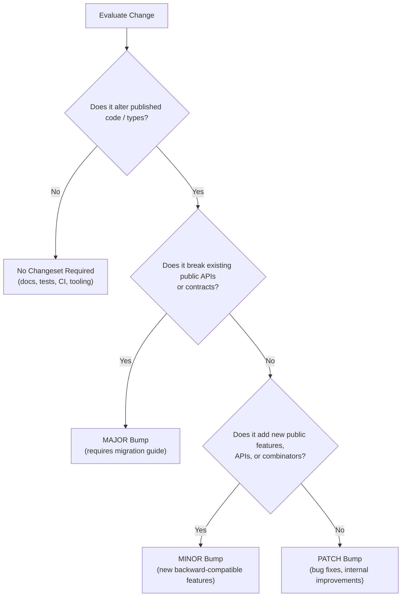

# Semantic Versioning Guide

This document establishes the semantic versioning specifications for `@luism/adt-ts`. All automated agents and contributors must adhere to these criteria when introducing modifications to the library.

---

## 1. Core Principle (SemVer 2.0.0)

Given a version number `MAJOR.MINOR.PATCH`:

- **`MAJOR`**: Incremented when you make incompatible API changes.
- **`MINOR`**: Incremented when you add functionality in a backward-compatible manner.
- **`PATCH`**: Incremented when you make backward-compatible bug fixes or internal maintenance.

---

## 2. Change Classifications

### 🚨 Major Version (`X.0.0`) — Breaking Changes

A major version bump is strictly required whenever a downstream consumer's code could fail to compile or produce altered behavior upon upgrading.

#### Breaking Change Checklist:

- [ ] **Export Removals / Renames**: Deleting or renaming any exported type, interface, class, function, or namespace (e.g., `Option`, `Result`, `Task`, `ADT`, `tag`, `matchTagged`).
- [ ] **Function Signature Changes**:
  - Adding mandatory parameters to existing public functions or constructors.
  - Reordering parameters in any public API.
  - Narrowing parameter types (making an accepted argument more restrictive).
  - Altering return types in a way that is not assignable to the prior return type.
- [ ] **Contractual Behavior Changes**:
  - Changing error-handling semantics (e.g., changing whether an error is caught or thrown in `Result.tryCatch` or `Task`).
  - Altering identity, equality, or discriminant tags in ADT unions (`_tag`, variant constructor outputs).
- [ ] **Platform / Engine Bumps**:
  - Dropping support for Node.js versions within the supported engine range (`>=16.0.0`).
  - Raising minimum TypeScript version in a way that breaks existing consumers.

---

### 🚀 Minor Version (`0.X.0` or `X.Y.0`) — Backward-Compatible Features

A minor version bump is required when new, backward-compatible capabilities are introduced.

#### Minor Feature Checklist:

- [ ] **New APIs / Functions**: Introducing new exported modules, utility functions, or combinators (e.g., adding `Option.filter`, `Result.fromThrowable`, `Task.parallel`).
- [ ] **Non-Breaking Signature Extensions**:
  - Adding optional parameters to existing functions or constructors.
  - Adding new optional properties to configuration or options interfaces.
- [ ] **Type Widening for Parameters**:
  - Expanding accepted parameter types (e.g., accepting `Iterable<T>` where previously only `Array<T>` was allowed).
- [ ] **Performance Optimizations**:
  - Algorithmic or memory optimizations that maintain exact observable behavior and API contracts.

---

### 🩹 Patch Version (`0.0.X` or `X.Y.Z`) — Backward-Compatible Bug Fixes

A patch version bump is required for fixes that correct unintended behavior without altering public contracts.

#### Patch Fix Checklist:

- [ ] **Bug Fixes**: Restoring intended functionality where code deviated from documented specifications or expected behavior.
- [ ] **Packaging & Bundle Fixes**: Adjusting dual ESM/CJS packaging, source maps, or declaration file emit that fixes bundle resolution without changing types or runtime APIs.
- [ ] **Internal Refactoring**: Improving internal implementation details without changing exported symbols, types, or public contracts.
- [ ] **Internal Dependency Updates**: Upgrading build tools or internal dependencies that alter the published artifact.

---

### 🚫 Non-Versioned Changes (No Changeset Required)

The following modifications do NOT impact consumers and must **not** include a changeset:

- Documentation improvements, docstring clarifications, typos in comments or `README.md`.
- `AGENTS.md` and `.agents/` guide updates.
- Test additions, test refactoring, and test fixtures.
- CI/CD workflow adjustments (`.github/workflows/*`) that do not alter the published package artifact.
- Local developer tooling and formatter configurations (`.oxfmtrc.json`, `.oxlintrc.json`).

---

## 3. Decision Matrix

Use the following flowchart to determine the appropriate bump level:

