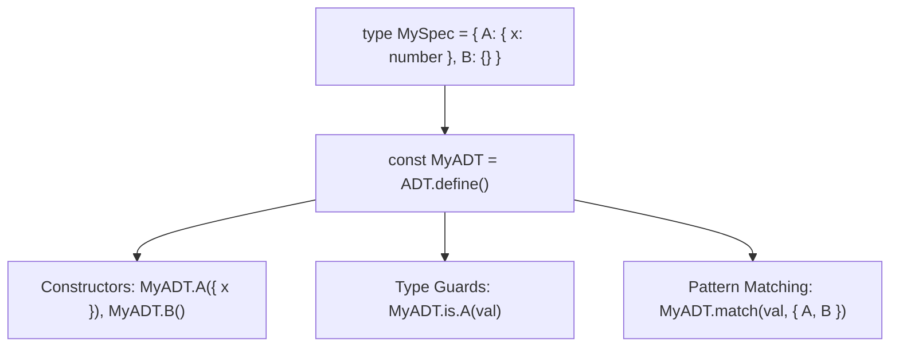

[🏠 Home](../README.md) · [Option](option.md) · [Result](result.md) · [Task](task.md) · **ADT**

---

# Custom Tagged Unions (`ADT`)

Ergonomic utilities for defining and pattern-matching custom Algebraic Data Types (sum types / discriminated unions) with compile-time exhaustiveness.

---

## Executive Summary

`ADT` eliminates the boilerplate of writing manual discriminated unions, generating lightweight constructors, runtime type guards, and compile-time exhaustive pattern matchers in under 300 bytes.

---

## Why & Key Benefits

TypeScript supports discriminated unions out of the box, but manually implementing them requires significant boilerplate and leaves room for incomplete `switch/case` handling:

| Failure Mode in Vanilla TS Unions | Failure Impact | `ADT` Solution | Engineering Advantage |
| :--- | :--- | :--- | :--- |
| **Boilerplate constructor definitions** | Defining interfaces, constructors, and types for 5+ variants requires repetitive boilerplate. | `ADT.define<Spec>()` provides constructors automatically via an ultra-lightweight Proxy. | **Zero boilerplate**: Define complete variant ecosystems in a single type specification map. |
| **Non-exhaustive `switch/case` statements** | Adding a new union variant compiles silently unless cumbersome `default: assertNever(x)` helper functions are manually maintained. | `ADT.match` demands a handler for every variant tag, producing compile-time errors if any branch is missing. | **100% compile-time exhaustiveness**: Adding a new variant immediately flags all unhandled code locations. |
| **Manual type guard creation** | Creating `isCircle(s): s is Circle` functions for each variant adds unnecessary maintenance. | `Module.is[Variant]` generates type predicates automatically. | **Instant type narrowing**: Clean type guards out of the box without manual predicates. |
| **Bundle size overhead** | Schema libraries and class hierarchies add significant bundle weight. | Implemented via a lightweight frozen Proxy with no runtime schema registration (< 300 bytes). | **Zero runtime overhead**: Maximum performance and minimal footprint across client and edge runtimes. |

### Before vs After

````carousel
```typescript
// ❌ Before: Verbose interface declarations, constructors, and switch-case
type Circle = { readonly _tag: "Circle"; readonly radius: number };
type Rectangle = { readonly _tag: "Rectangle"; readonly width: number; readonly height: number };
type Shape = Circle | Rectangle;

// Manual constructors
const Circle = (radius: number): Circle => ({ _tag: "Circle", radius });
const Rectangle = (width: number, height: number): Rectangle => ({ _tag: "Rectangle", width, height });

// Manual switch-case with assertNever boilerplate
function getArea(shape: Shape): number {
  switch (shape._tag) {
    case "Circle":
      return Math.PI * shape.radius ** 2;
    case "Rectangle":
      return shape.width * shape.height;
    default: {
      const _exhaustive: never = shape;
      throw new Error(`Unhandled shape: ${_exhaustive}`);
    }
  }
}
```
<!-- slide -->
```typescript
// ✅ After: Declarative specification, automatic constructors, and exhaustive match
import { ADT, type ADTUnion } from "@luism/adt-ts/adt";

type ShapeSpec = {
  Circle: { radius: number };
  Rectangle: { width: number; height: number };
  Point: {};
};

const Shape = ADT.define<ShapeSpec>();
type Shape = ADTUnion<ShapeSpec>;

const shape = Shape.Circle({ radius: 10 });

// Fully exhaustive: omitting any branch triggers a TypeScript compiler error!
const area = Shape.match(shape, {
  Circle: ({ radius }) => Math.PI * radius ** 2,
  Rectangle: ({ width, height }) => width * height,
  Point: () => 0,
});
```
````

---

## When to Use It (and When Not To)

### Ideal Scenarios
- **Domain State Machines**: Modeling finite states (e.g., `PaymentState`: `Idle`, `Authorizing`, `Captured`, `Refunded`, `Failed`).
- **UI State Models**: Representing component view states (`Loading`, `Empty`, `Data`, `Error`).
- **Domain Events & Actions**: Event-driven architectures where distinct event payloads require strict routing.
- **Abstract Syntax Trees (AST)**: Parsers, compilers, and DSL expression representations.

### When Not To Use
- **Simple Missing Values**: If you only need to represent present vs absent data, use [`Option<T>`](option.md).
- **Simple Success vs Failure**: If you only have success and error channels, use [`Result<T, E>`](result.md).

---

## Mental Model & Architecture



1. **Specification Map (`Spec`)**: A standard TypeScript object type mapping variant tags to property bags.
2. **`ADT.define<Spec>()`**: Produces a module carrying constructors, `.is` type guards, `.match`, and `.matchPartial`.
3. **Tags**: Every generated variant automatically receives a `readonly _tag` discriminator matching its key name.

---

## Core API & Common Patterns

### 1. Defining ADTs

```typescript
import { ADT, type ADTUnion } from "@luism/adt-ts/adt";

type ConnectionSpec = {
  Disconnected: {};
  Connecting: { attempt: number };
  Connected: { sessionId: string; latencyMs: number };
  Failed: { reason: string; retryable: boolean };
};

export const Connection = ADT.define<ConnectionSpec>();
export type Connection = ADTUnion<ConnectionSpec>;
```

### 2. Creating Variants

```typescript
// Parameterless variants require no arguments
const initial = Connection.Disconnected();

// Variants with payloads require matching property records
const connecting = Connection.Connecting({ attempt: 1 });
const connected = Connection.Connected({ sessionId: "sess_xyz", latencyMs: 24 });
const failed = Connection.Failed({ reason: "Timeout", retryable: true });
```

### 3. Type Guards

```typescript
const state: Connection = getConnectionState();

if (Connection.is.Connected(state)) {
  // state is narrowed to ADTVariant<"Connected", { sessionId: string, latencyMs: number }>
  console.log(`Connected to ${state.sessionId} with ${state.latencyMs}ms ping`);
}
```

### 4. Exhaustive Pattern Matching (`match`)

Omitting any tag will cause TypeScript compilation to fail:

```typescript
const statusMessage = Connection.match(state, {
  Disconnected: () => "Offline",
  Connecting: ({ attempt }) => `Connecting (attempt #${attempt})...`,
  Connected: ({ latencyMs }) => `Online (${latencyMs}ms)`,
  Failed: ({ reason }) => `Connection failed: ${reason}`,
});
```

### 5. Partial Pattern Matching (`matchPartial`)

Handle specific variants with an `otherwise` fallback:

```typescript
const isOnline = Connection.matchPartial(
  state,
  {
    Connected: () => true,
  },
  (_other) => false,
);
```

### 6. Working with Standalone Tagged Objects

If you have arbitrary tagged objects matching `{ readonly _tag: string }`, you can match on them directly:

```typescript
import { matchTagged, tag } from "@luism/adt-ts/adt";

type Action = { _tag: "increment"; amount: number } | { _tag: "reset" };

const action = tag("increment", { amount: 5 });

const delta = matchTagged(action, {
  increment: ({ amount }) => amount,
  reset: () => 0,
});
```

---

## Real-World Example: Order Checkout State Machine

```typescript
import { ADT, type ADTUnion } from "@luism/adt-ts/adt";

type CheckoutSpec = {
  CartReview: { itemCount: number; totalCents: number };
  ProcessingPayment: { orderId: string; processor: string };
  Complete: { orderId: string; receiptUrl: string };
  Rejected: { orderId: string; reason: string; canRetry: boolean };
};

const Checkout = ADT.define<CheckoutSpec>();
type Checkout = ADTUnion<CheckoutSpec>;

function renderCheckoutView(state: Checkout): string {
  return Checkout.match(state, {
    CartReview: ({ itemCount, totalCents }) =>
      `Review Cart: ${itemCount} items ($${(totalCents / 100).toFixed(2)})`,
    ProcessingPayment: ({ orderId, processor }) =>
      `Authorizing order ${orderId} via ${processor}...`,
    Complete: ({ orderId, receiptUrl }) =>
      `Thank you for your order #${orderId}! Receipt: ${receiptUrl}`,
    Rejected: ({ reason, canRetry }) =>
      `Payment declined: ${reason}. ${canRetry ? "Please try another card." : "Contact support."}`,
  });
}

// Usage:
const orderState: Checkout = Checkout.Complete({
  orderId: "ord_1024",
  receiptUrl: "https://example.com/receipts/1024.pdf",
});

console.log(renderCheckoutView(orderState));
```

---

## API Quick Reference

| Function / Property | Signature | Description |
| :--- | :--- | :--- |
| `ADT.define<Spec>()` | `() => ADTModule<Spec>` | Defines constructors, `.is` guards, and matchers for `Spec`. |
| `ADTUnion<Spec>` | `type` | Type alias representing the union of all variants in `Spec`. |
| `ADTVariant<Tag, Props>` | `type` | Type alias for a single variant with `{ readonly _tag: Tag } & Props`. |
| `Module[Variant](props?)` | `(props) => ADTVariant<Variant, Props>` | Variant constructor function. |
| `Module.is[Variant](val)` | `(val: ADTUnion<Spec>) => val is ADTVariant` | Type guard checking if `val._tag === Variant`. |
| `Module.match(val, patterns)` | `(val, patterns: ExhaustivePatterns) => R` | Exhaustively pattern matches on all variant tags. |
| `Module.matchPartial(val, patterns, fallback)` | `(val, patterns, otherwise) => R \| F` | Partially matches variants with an `otherwise` callback. |
| `tag(tagName, props?)` | `(tag: Tag, props?: Props) => ADTVariant` | Utility helper returning a frozen `{ _tag, ...props }` object. |
| `matchTagged(val, patterns)` | `(val: U, patterns: ExhaustivePatterns) => R` | Standalone exhaustive pattern matcher for any tagged union. |
| `matchTaggedPartial(val, patterns, otherwise)` | `(val: U, patterns, otherwise) => R \| F` | Standalone partial pattern matcher with fallback. |

---

[← Task](task.md) · [🏠 Home](../README.md) · [Option](option.md)
