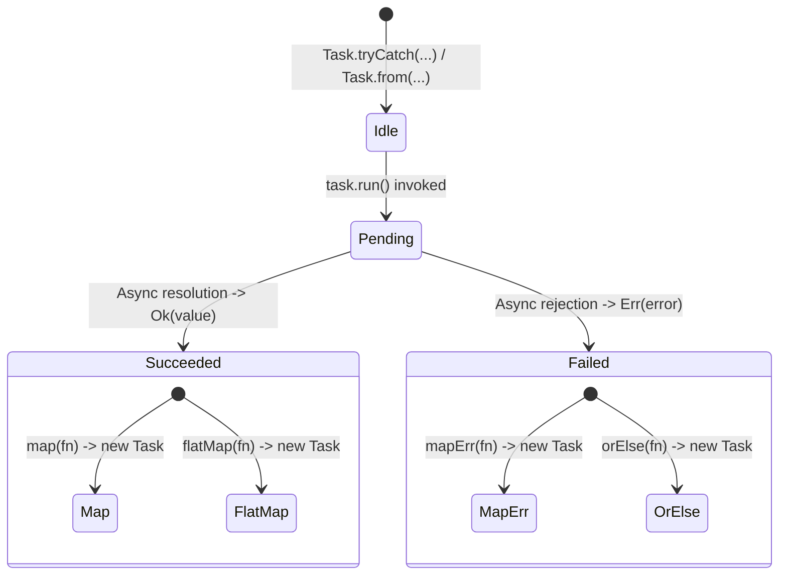

[🏠 Home](../README.md) · [Option](option.md) · [Result](result.md) · **Task** · [ADT](adt.md)

---

# `Task<T, E>`

An algebraic data type that represents a deferred, lazy asynchronous computation resolving to a `Result<T, E>`.

---

## Executive Summary

`Task<T, E>` provides controlled, non-throwing asynchronous execution with explicit typed errors, lazy evaluation, and synchronous lifecycle state inspection.

---

## Why & Key Benefits

Native JavaScript `Promise`s are eager, untyped in their failure channel, and prone to unhandled rejections that crash applications. `Task<T, E>` rectifies these operational issues:

| Failure Mode in Vanilla JS/TS Promises | Failure Impact | `Task<T, E>` Solution | Engineering Advantage |
| :--- | :--- | :--- | :--- |
| **Eager execution on creation** | Promises start network/disk I/O the instant `new Promise(...)` is called, preventing easy composition, retries, or deferred scheduling. | Lazy evaluation: computation only begins when `.run()` is explicitly invoked. | **Controlled execution**: Build complex async dependency graphs before triggering execution. |
| **Unhandled Promise Rejections** | Forgetting `.catch()` crashes Node.js processes (`ERR_UNHANDLED_REJECTION`) or triggers window error events. | `.run()` never rejects; it always resolves to a `Result<T, E>`. | **Zero unhandled crashes**: Async errors are safely contained in the type system. |
| **Untyped error channel (`Promise<T>`)** | Rejections lose type fidelity (`catch (e: unknown)`), making robust error handling difficult. | The error type `E` is tracked in the type signature alongside `T`. | **Type-safe async pipelines**: Transform and handle specific error types with full compiler verification. |
| **Opaque execution state** | Native promises cannot be inspected synchronously to check if they are pending, succeeded, or failed. | Exposes synchronous status getters: `getStatus()`, `isIdle()`, `isPending()`, `isSucceeded()`, `isFailed()`. | **Effortless UI state binding**: Directly bind component loading spinners and error states without extra state variables. |

### Before vs After

````carousel
```typescript
// ❌ Before: Eager execution, unhandled rejections, and untyped error catch
async function fetchUser(id: string): Promise<User> {
  // Starts running immediately when called!
  const res = await fetch(`/api/users/${id}`);
  if (!res.ok) {
    throw new Error(`HTTP ${res.status}`); // Throws untyped error
  }
  return res.json();
}

// Caller must remember try/catch; if omitted, crashes process:
try {
  const user = await fetchUser("123");
} catch (e: unknown) {
  // Type of e is unknown
  console.error(e);
}
```
<!-- slide -->
```typescript
// ✅ After: Lazy, non-throwing Task with explicit typed errors
import { Task } from "@luism/adt-ts/task";

type HttpError = { status: number; message: string };

function fetchUser(id: string): Task<User, HttpError> {
  return Task.tryCatch(
    async () => {
      const res = await fetch(`/api/users/${id}`);
      if (!res.ok) {
        throw { status: res.status, message: res.statusText };
      }
      return (await res.json()) as User;
    },
    (err) => err as HttpError,
  );
}

// Nothing executes until .run() is called:
const outcome = await fetchUser("123").run(); // Promise<Result<User, HttpError>>, never throws!
if (outcome.isOk()) {
  console.log("User:", outcome.unwrap().name);
} else {
  console.error("HTTP error:", outcome.unwrapErr().status);
}
```
````

---

## When to Use It (and When Not To)

### Ideal Scenarios
- **API & Network Operations**: HTTP requests, RPC calls, WebSocket communications that can fail with status codes.
- **Database & Disk I/O**: Queries, file access, and caching operations requiring deferred execution or retry logic.
- **Coordinated Async Workflows**: Combining multiple async tasks in parallel (`Task.all`), in sequence (`Task.sequence`), or racing them (`Task.race`).
- **UI State Management**: React / frontend components tracking `idle`, `pending`, `succeeded`, and `failed` lifecycles.

### When Not To Use
- **Pure Synchronous Computations**: If the operation does not return a Promise, prefer [`Result<T, E>`](result.md) or [`Option<T>`](option.md).
- **Fire-and-Forget Streaming**: For continuous streams of events (e.g., RxJS Observables, Node streams), an event emitter or async iterator is more appropriate.

---

## Mental Model & Flow

A `Task<T, E>` transitions through defined lifecycle states and always yields a `Result<T, E>` upon resolution:



Key characteristics:
- **Purity**: Defining a `Task` does not cause side effects.
- **Reusability**: You can call `.run()` multiple times on the same task instance if needed.
- **Safety**: Calling `.run()` returns a `Promise<Result<T, E>>` that **never rejects**.

---

## Core API & Common Patterns

### 1. Constructors

```typescript
import { Task } from "@luism/adt-ts/task";

// Wrap an async function that might throw
const fetchTask = Task.tryCatch(
  async () => {
    const res = await fetch("/api/data");
    return res.json();
  },
  (err) => new Error(`Network error: ${String(err)}`),
);

// Immediately settled tasks
const successTask = Task.success(100); // or Task.ok(100)
const failureTask = Task.failure(new Error("Unauthorized")); // or Task.err(...)

// Wrap a Result directly
import { Result } from "@luism/adt-ts/result";
const fromRes = Task.fromResult(Result.ok("ready"));
```

### 2. Execution & Status Inspection

```typescript
const task = Task.tryCatch(async () => 42);

console.log(task.getStatus()); // "idle"
console.log(task.isIdle()); // true

// Trigger execution
const execution = task.run();
console.log(task.getStatus()); // "pending"

const result = await execution; // Result<number, Error>
console.log(task.getStatus()); // "succeeded"
console.log(task.getResult()); // 42
console.log(task.toResult()); // Option.some(Result.ok(42))
```

### 3. Asynchronous Chaining & Recovery

```typescript
// map & flatMap compose cleanly without executing
const workflow = fetchUser("usr_1")
  .map((user) => user.organizationId)
  .flatMap((orgId) => fetchOrganization(orgId))
  .orElse((err) => Task.success(getDefaultOrganization()));

// Trigger entire multi-step pipeline at once
const finalOutcome = await workflow.run();
```

### 4. Concurrency Combinators

```typescript
const taskA = Task.tryCatch(async () => fetchMetricA());
const taskB = Task.tryCatch(async () => fetchMetricB());

// Task.all: Run concurrently, collect all Ok values, short-circuit on first Err
const combined = await Task.all([taskA, taskB]).run(); // Result<[MetricA, MetricB], Error>

// Task.sequence: Run sequentially (taskB only runs after taskA succeeds)
const ordered = await Task.sequence([taskA, taskB]).run();

// Task.race: Run concurrently, settle with first to complete
const fastest = await Task.race([taskA, taskB]).run();
```

---

## Real-World Example: Resilient API Fetch with Fallback

```typescript
import { Task } from "@luism/adt-ts/task";

interface Product {
  id: string;
  title: string;
  price: number;
}

type ApiError = { type: "NETWORK_ERROR"; message: string } | { type: "NOT_FOUND"; id: string };

function fetchProduct(id: string): Task<Product, ApiError> {
  return Task.tryCatch(
    async () => {
      const res = await fetch(`https://api.example.com/products/${id}`);
      if (res.status === 404) {
        throw { type: "NOT_FOUND", id } as ApiError;
      }
      if (!res.ok) {
        throw { type: "NETWORK_ERROR", message: `HTTP ${res.status}` } as ApiError;
      }
      return (await res.json()) as Product;
    },
    (err) => err as ApiError,
  );
}

function getProductWithLocalFallback(id: string): Task<Product, ApiError> {
  return fetchProduct(id).orElse((error) => {
    if (error.type === "NOT_FOUND") {
      // Don't fallback for genuine 404s
      return Task.failure(error);
    }
    // Fallback to local cached product on network issues
    return Task.success({
      id,
      title: "Offline Cached Product",
      price: 0,
    });
  });
}

// Execution:
const productOutcome = await getProductWithLocalFallback("prod_99").run();

productOutcome.match({
  ok: (product) => console.log(`Loaded: ${product.title} ($${product.price})`),
  err: (err) => console.error("Could not load product:", err),
});
```

---

## API Quick Reference

| Method / Function | Signature | Description |
| :--- | :--- | :--- |
| `Task.from(thunk)` | `(thunk: () => Promise<Result<T, E>>) => Task<T, E>` | Creates lazy task from a Result-returning thunk. |
| `Task.tryCatch(fn, onError?)` | `(fn: () => Promise<T>, onError?) => Task<T, E>` | Creates lazy task catching throws into `Result.err`. |
| `Task.success(value)` | `(value: T) => Task<T, never>` | Creates immediately succeeded task. |
| `Task.failure(error)` | `(error: E) => Task<never, E>` | Creates immediately failed task. |
| `Task.fromResult(result)` | `(result: Result<T, E>) => Task<T, E>` | Lifts an existing `Result` into a settled task. |
| `Task.fromOption(opt, err)` | `(option: Option<T>, error: E) => Task<T, E>` | Lifts an `Option` into a settled task. |
| `Task.all(tasks)` | `(tasks: Iterable<Task<T, E>>) => Task<T[], E>` | Runs tasks concurrently via `Promise.all`. |
| `Task.sequence(tasks)` | `(tasks: Iterable<Task<T, E>>) => Task<T[], E>` | Runs tasks sequentially in series. |
| `Task.race(tasks)` | `(tasks: Iterable<Task<T, E>>) => Task<T, E>` | Settles with first task to finish. |
| `task.run()` | `() => Promise<Result<T, E>>` | Executes task; **never rejects**. |
| `task.runOrThrow()` | `() => Promise<T>` | Executes task; resolves `T` or rejects `E`. |
| `task.map(fn)` | `(fn: (v: T) => U) => Task<U, E>` | Lazily transforms success value. |
| `task.mapErr(fn)` | `(fn: (e: E) => F) => Task<T, F>` | Lazily transforms error value. |
| `task.bimap(onOk, onErr)` | `(onOk: (v: T) => U, onErr: (e: E) => F) => Task<U, F>` | Lazily transforms both channels. |
| `task.flatMap(fn)` | `(fn: (v: T) => Task<U, F>) => Task<U, E \| F>` | Chains another async task or result (alias `andThen`). |
| `task.orElse(fn)` | `(fn: (e: E) => Task<T, F>) => Task<T, F>` | Recovers from task failure. |
| `task.tap(fn)` | `(fn: (v: T) => void) => Task<T, E>` | Runs side effect on success value when run. |
| `task.tapErr(fn)` | `(fn: (e: E) => void) => Task<T, E>` | Runs side effect on error value when run. |
| `task.match(patterns)` | `(patterns: ResultMatcher<T, E, R>) => Promise<R>` | Executes task and pattern matches outcome. |
| `task.getStatus()` | `() => "idle" \| "pending" \| "succeeded" \| "failed"` | Returns synchronous execution status. |
| `task.isIdle()` | `() => boolean` | Checks if task has not yet run. |
| `task.isPending()` | `() => boolean` | Checks if task is actively executing. |
| `task.isSucceeded()` | `() => boolean` | Checks if task succeeded. |
| `task.isFailed()` | `() => boolean` | Checks if task failed. |
| `task.getResult()` | `() => T \| undefined` | Synchronously reads success value if succeeded. |
| `task.getError()` | `() => E \| undefined` | Synchronously reads error value if failed. |
| `task.toResult()` | `() => Option<Result<T, E>>` | Converts current status into synchronous `Option`. |

---

[← Result](result.md) · [🏠 Home](../README.md) · [Next: ADT →](adt.md)
